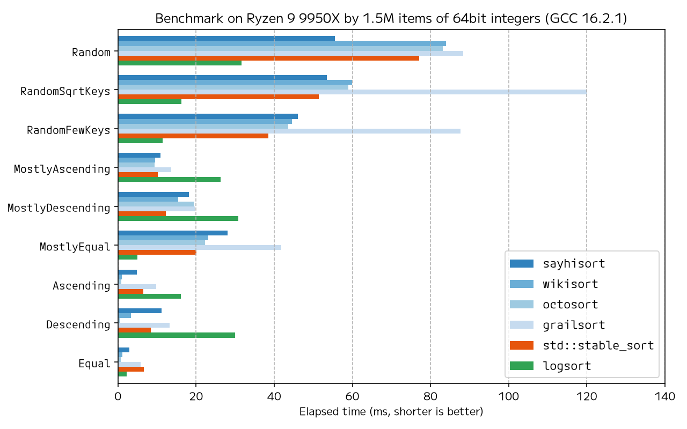
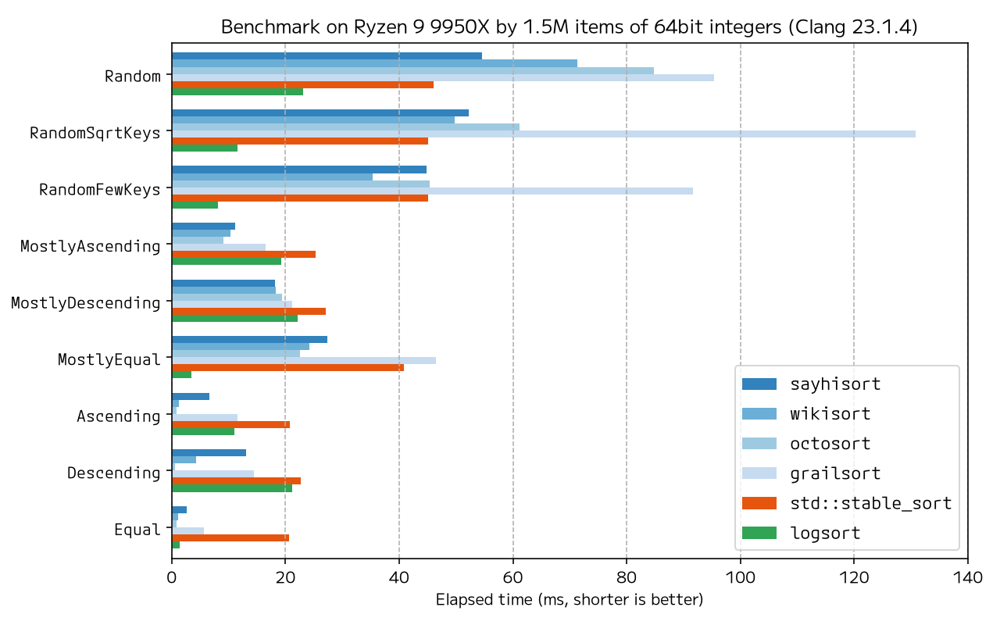

# SayhiSort

**Fast, portable and easy-to-use block merge sort implementation** written in C++17, inspired by [GrailSort](https://github.com/Mrrl/GrailSort). It's **in-place, stable and runs in O(N log(N)) worst-case time complexity**. Its interface is compatible with `std::sort` and `std::ranges::sort` (C++20).

**Any items can be sorted as long as they are comparable and swappable.** They need not be default-constructible or move-constructible. The implementation doesn't use any pre-allocated buffer to store items, contrary to other block merge sort implementations. Despite the absence of the buffer, it shows **state-of-the-art performance**.

Substantial effort is made for portability and security. **No floating point number** is used, and the code is carefully written and tested to avoid overflow in any integer-like index type. There are meticulous comments to clarify mathematical invariants.

Its name derives from GrailSort, in memory of its author [Andrey Astrelin](https://superliminal.com/andrey/biography.html). “Say hi” sounds like the Japanese word 「聖杯（せいはい）」, which means grail.

## Usage

It's a header-only C++ library, so just including `sayhisort.h` is fine. You can also import it as a CMake external project. It provides the `sayhisort::sort` function, which is compatible with `std::sort`.


```cpp
template <typename Iterator, typename Sentinel, typename Comp = std::less<>>
Iterator sayhisort::sort(Iterator first, Sentinel last, Comp comp = {});

```

To use the interface compatible with `std::ranges::sort`, you need to compile `sayhisort.h` as C++20 or later. The interface is constrained by concepts.

```cpp
template <std::random_access_iterator I, std::sentinel_for<I> S,
          typename Comp = std::ranges::less, typename Proj = std::identity>
    requires std::indirectly_swappable<I> &&
             std::indirect_strict_weak_order<Comp, std::projected<I, Proj>>
constexpr I
sayhisort::sort(I first, S last, Comp comp = {}, Proj proj = {});

template <std::ranges::random_access_range R,
         typename Comp = std::ranges::less, typename Proj = std::identity>
    requires std::indirectly_swappable<std::ranges::iterator_t<R>> &&
             std::indirect_strict_weak_order<
                 Comp, std::projected<std::ranges::iterator_t<R>, Proj>>
constexpr std::ranges::borrowed_iterator_t<R>
sayhisort::sort(R&& range, Comp comp = {}, Proj proj = {});
```

## Benchmark





Note that other block merge sort implementations ([WikiSort](https://github.com/BonzaiThePenguin/WikiSort/), [octosort](https://github.com/scandum/octosort) and [GrailSort](https://github.com/Mrrl/GrailSort)) use a pre-allocated buffer that stores 512 items. Though the buffer is claimed to be crucial for performance, SayhiSort exhibits competitive speed.

You may notice SayhiSort performs poorly on some data, compared to WikiSort and octosort. This shows whether each algorithm is tuned to already sorted data. Since SayhiSort is still fast on such data, the author believes there's no problem at all.

[Logsort](https://github.com/aphitorite/Logsort)'s excellent performance is noteworthy. The algorithm is completely different from the others based on merge sort. It's basically a variant of quicksort, using a novel tagging technique to ensure stability. Despite its practical performance, some caution is needed since its worst-case time complexity is O(N^2).

Raw benchmark result is available in [`bench_result`](bench_result/) directory. You can run the benchmark by yourself as follows.

```sh
mkdir build
pushd build
CC=gcc CXX=g++ cmake -DSAYHISORT_THIRDPARTY_BENCH=ON -GNinja ..
popd
ninja -C build
build/tests/sayhisort_bench > bench_result/gcc.yml

mkdir build_clang
pushd build_clang
CC=clang CXX=clang++ cmake -DSAYHISORT_THIRDPARTY_BENCH=ON -GNinja ..
popd
ninja -C build_clang
build_clang/tests/sayhisort_bench > bench_result/clang.yml

cd bench_result
./plot.py
```

## Testing

Unit tests and a randomized test are run by CTest. The randomized test compares the result with `std::stable_sort` on various inputs, using an iterator that detects out-of-bounds access.

```sh
cmake -B build -GNinja
ninja -C build
ctest --test-dir build
```

Sanitizers can be applied to the tests with GCC or Clang.

```sh
cmake -B build_asan -GNinja -DSAYHISORT_SANITIZE=address,undefined
```

A [libFuzzer](https://llvm.org/docs/LibFuzzer.html) target is also available with Clang.

```sh
CC=clang CXX=clang++ cmake -B build_fuzz -GNinja -DSAYHISORT_ENABLE_FUZZER=ON -DSAYHISORT_SANITIZE=address,undefined
ninja -C build_fuzz sayhisort_fuzzer
build_fuzz/tests/sayhisort_fuzzer -max_total_time=60
```

## Similar projects

### Block merge sort

* https://github.com/BonzaiThePenguin/WikiSort/
* https://github.com/scandum/octosort
* https://github.com/HolyGrailSortProject/Rewritten-Grailsort
* https://github.com/HolyGrailSortProject/Holy-Grailsort
* https://github.com/ecstatic-morse/MrrlSort/

### Other fast in-place and stable sort

* https://github.com/aphitorite/Logsort

  Quicksort with stable partitioning, which is empirically very fast. Its partitioning algorithm, which interprets sequences' arrangement as tag bits, is very elegant. While it has O(N^2) worst-case time complexity and requires a buffer to hold log2(N) items, arguably there's room for further improvement.

## Algorithm detail

SayhiSort is a variant of bottom-up block merge sort that

* searches for (approximately) 2√N unique keys for imitation buffer and data buffer at first, and
* alternately applies left-to-right merge and right-to-left merge to skip needless buffer movement, if data buffer is available.

While all algorithm code is written by the author, many ideas come from others' research and implementations.

### Searching unique keys

Its overhead heavily depends on input data. If the data has slightly fewer than 2√N unique keys, it performs worst.

It's hard to eliminate the bottleneck without a pre-allocated buffer, so a marginal performance drop is observed. Thus SayhiSort isn't the fastest on the `RandomSqrtKeys` benchmark, while its performance is still not that bad.

### Sorting blocks

This takes a noticeable amount of time.

When two sequences are merged, each sequence is divided into approximately `sqrt(len) / 2` blocks, where `len` is the total length of the two sequences. The blocks are merged in-place. The merge algorithm is similar to basic merge sort, but it uses selection sort to search the smallest block in the left sequence.

This algorithm is quite basic in block merge sort. Though some micro-optimizations were tried, the results were inconclusive. Currently there is no idea for further speed-up.

### Merging blocks

This is the most time-consuming routine.

When the data buffer is available, basically a textbook merge algorithm is used. Current implementation applies [cross merge](https://github.com/scandum/quadsort#cross-merge) technique for optimization.

Some adaptive merge logic can significantly improve performance, since the length of two sequences `xs` and `ys` can differ. Depending on data, `ys` can be much longer than `xs`.

When the data buffer isn't available, an in-place merge algorithm is required. The algorithm repeats the following procedure to merge sequences `xs` and `ys`:

* find the index `i` such that `xs[i] > ys[0]` by binary searching `xs`
* find the index `j` such that `xs[i] <= ys[j]` by binary searching `ys`, and
* rotate `xs[i:]` and `ys[:j]`.

The computational complexity is still linear, since the algorithm is used only if the number of unique keys is small. In practice, however, the in-place merge algorithm is a bit slow. SayhiSort avoids any pre-allocated buffer, so it frequently resorts to in-place merging. Therefore it shows mediocre performance on the `RandomFewKeys` benchmark.

### Sorting short sequences

This takes a small but non-negligible amount of time.

When the sequence length is less than or equal to 8, the implementation uses odd-even sort, which is stable and parallelizable by superscalar execution. To sort many short sequences, a heavily optimized loop dispatches specialized odd-even sort functions.

The author is reluctant to optimize further, because it would likely bloat the inlined code.

### Sorting unique keys

Its cost is currently negligible, so it isn't worth micro-optimizing.

To de-interleave the imitation buffer, bin-sorting is used if the data buffer can be used as an auxiliary space. Otherwise a novel O(K log(K)) algorithm is used, where K is the number of unique keys collected. This algorithm iteratively rotates skewed parts. See [comments](https://github.com/grafi-tt/sayhisort/blob/1a5833f27aaeeb9c463a971ceabd35f51af4c9a9/sayhisort.h#L476-L485) for detail.

The data buffer is sorted by heapsort. Its solid computational complexity gives comfort to the author, even though Shell sort may perform well.

### Rotation sub-algorithm detail

Uses [Helix rotation](https://github.com/scandum/rotate#helix-rotation) for large data, because of its simple control flow and cache memory friendliness. Switches to triple reversal when the length becomes small, to avoid integer modulo operation in Helix rotation.

The author noticed that the swapping loop in Helix rotation can be vectorized. The distance of its loop-carried dependence equals the length of the shorter chunk, so items can be swapped by SIMD instructions if the shorter chunk is at least as long as the vector width. An experiment showed that it makes rotation-heavy inputs such as `MostlyEqual` 5-12% faster. Nevertheless, SIMD isn't used for the following reasons.

* Explicit vectorization requires detecting contiguous iterators, but `std::contiguous_iterator` is unavailable in C++17.
* It makes the code more complex.
* Auto-vectorization by compilers is unstable, since the dependence distance varies with the rotation width. GCC vectorizes the loop even if the distance is short and not a multiple of the vector width, which causes store-to-load forwarding failures. Clang doesn't use vectorized code if the swapped ranges overlap. Thus auto-vectorization is disabled for the loop.

### Binary search sub-algorithm detail

Uses [monobound binary search](https://github.com/scandum/binary_search). In general, the number of comparisons to identify an item from N choices is at most ceil(log2(N)). The routine always performs this fixed number of comparisons. Though there is a redundant comparison, its simple loop, friendly to branch prediction, certainly wins.

### Optimal sequence division technique

Data are divided into sequences as evenly as possible if the input length is non-power-of-2. In principle, the length of each sequence is treated as a rational number. Actual implementation uses bit operations for the sake of efficiency. The author learned this technique from [WikiSort](https://github.com/BonzaiThePenguin/WikiSort/blob/master/Chapter%202.%20Merging.md).
