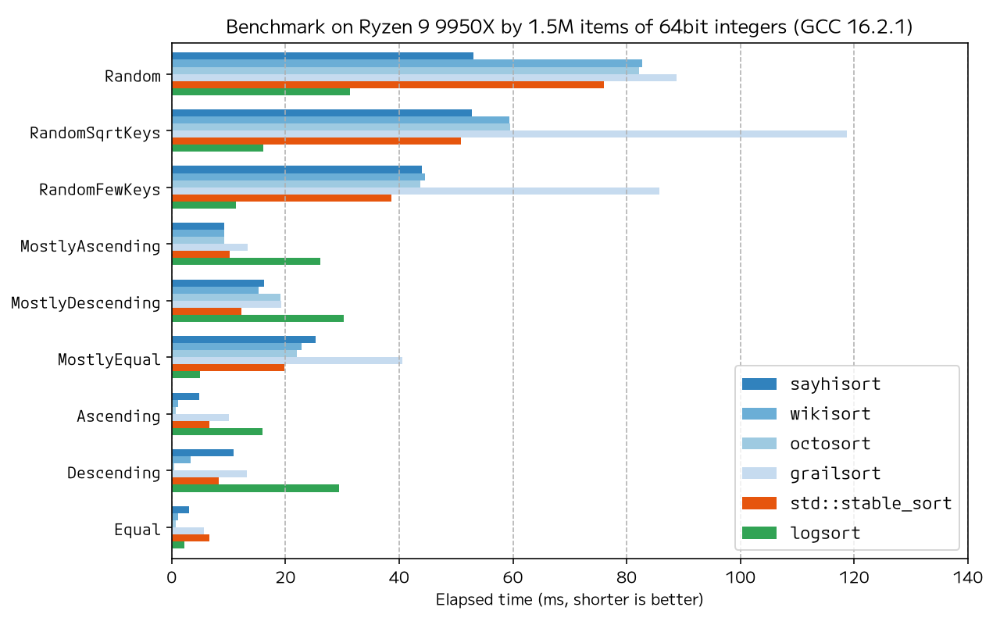
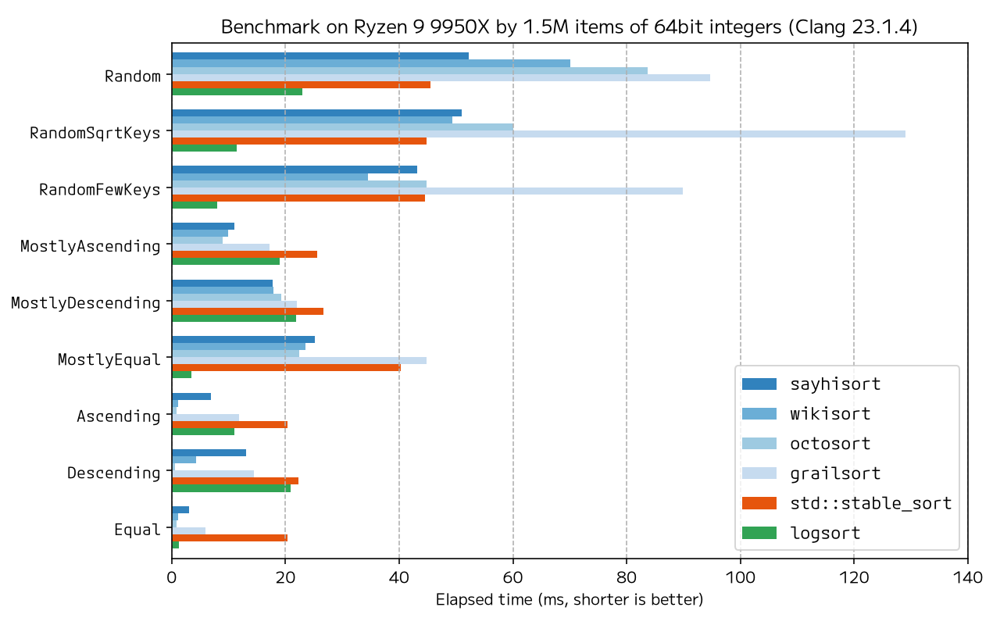
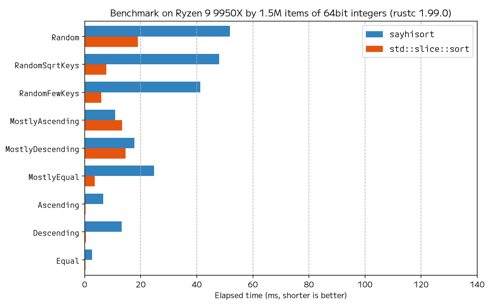

# SayhiSort

**Fast, portable and easy-to-use block merge sort implementation** written in C++17 and Rust, inspired by [GrailSort](https://github.com/Mrrl/GrailSort). It's **in-place, stable and runs in O(N log(N)) worst-case time complexity**. The C++ interface is compatible with `std::sort` and `std::ranges::sort` (C++20), and the Rust interface mirrors `slice::sort` and `slice::sort_by`.

**In C++, any items can be sorted as long as they are comparable and swappable.** They need not be default-constructible or move-constructible. **In Rust, it needs no allocator and works in `no_std` environments**, where the standard library provides no stable sort. Neither implementation uses any pre-allocated buffer to store items, contrary to other block merge sort implementations. Despite the absence of the buffer, it shows **state-of-the-art performance**.

Substantial effort is made for portability and security. **No floating point number** is used, and the code is carefully written and tested to avoid overflow in any integer-like index type. There are meticulous comments to clarify mathematical invariants.

Its name derives from GrailSort, in memory of its author [Andrey Astrelin](https://superliminal.com/andrey/biography.html). “Say hi” sounds like the Japanese word 「聖杯（せいはい）」, which means grail.

## Usage

### C++

It's a header-only C++ library in the [`cpp`](cpp/) directory, so just including `sayhisort.h` is fine. You can also import the `cpp` directory as a CMake project, e.g. by `FetchContent` with `SOURCE_SUBDIR cpp`. It provides the `sayhisort::sort` function, which is compatible with `std::sort`.

```cpp
template <typename Iterator, typename Sentinel, typename Comp = std::less<>>
Iterator sayhisort::sort(Iterator first, Sentinel last, Comp comp = {});
```

To use the interface compatible with `std::ranges::sort`, you need to compile `sayhisort.h` as C++20 or later. The interface is constrained by concepts.

```cpp
template <std::random_access_iterator I, std::sentinel_for<I> S,
          typename Comp = std::ranges::less, typename Proj = std::identity>
    requires std::indirectly_swappable<I> &&
             std::indirect_strict_weak_order<Comp, std::projected<I, Proj>>
constexpr I
sayhisort::sort(I first, S last, Comp comp = {}, Proj proj = {});

template <std::ranges::random_access_range R,
          typename Comp = std::ranges::less, typename Proj = std::identity>
    requires std::indirectly_swappable<std::ranges::iterator_t<R>> &&
             std::indirect_strict_weak_order<
                 Comp, std::projected<std::ranges::iterator_t<R>, Proj>>
constexpr std::ranges::borrowed_iterator_t<R>
sayhisort::sort(R&& range, Comp comp = {}, Proj proj = {});
```

### Rust

The Rust implementation in the [`rust`](rust/) directory is a port of the C++ one and shares the same algorithm. It isn't published on crates.io yet, so add it as a git dependency.

```toml
[dependencies]
sayhisort = { git = "https://github.com/grafi-tt/sayhisort" }
```

It provides the following functions, which have the same semantics as `slice::sort` and `slice::sort_by`.

```rust
pub fn sort<T: Ord>(v: &mut [T]);
pub fn sort_by<T, F: FnMut(&T, &T) -> Ordering>(v: &mut [T], compare: F);
```

The crate is `#![no_std]` and **never allocates memory**. In contrast, `slice::sort` is unavailable without the `alloc` crate, since it requires a heap allocator for its working buffer, and `core` only provides the unstable `slice::sort_unstable`. CI checks that the crate builds for a bare-metal RISC-V target (`riscv32imc-unknown-none-elf`), and tests run on 64-bit Linux, macOS and Windows, and on 32-bit x86 Linux.

Items need not be `Copy`, `Clone` or `Default`, and zero-sized types are supported. Like the standard library, it guarantees memory safety even when the comparator is inconsistent or panics: the slice is left as a permutation of the input, without double drop or leak.

#### Smaller code with the `mini` feature

For targets where the binary size matters, such as microcontrollers, the `mini` feature makes the code about half as large at some cost of speed. It's intended to be used with `opt-level = "s"` or `"z"`. Set the opt-level of the profile itself, not a per-package override for `sayhisort`, because the generic sort functions are compiled in the crate that calls them.

```toml
[dependencies]
sayhisort = { git = "https://github.com/grafi-tt/sayhisort", features = ["mini"] }

[profile.release]
opt-level = "s"
```

Sorting 64-bit integers by `sayhisort::sort` on x86-64 (rustc 1.99.0 with LTO) has the following code size.

| | Code size (`"s"`) | Code size (`"z"`) |
|---|---|---|
| Default | 7850 bytes | 7489 bytes |
| `mini` | 4072 bytes (-48%) | 3783 bytes (-49%) |

TODO: Add the sorting time of `mini` compared to the default with `opt-level = "s"`, and of the default with `opt-level = "s"` compared to `opt-level = 3`, measured on the same machine as the [benchmarks](#benchmark).

The `mini` feature drops optimizations for superscalar execution, so the slowdown is expected to be smaller on simple cores with low instruction-level parallelism, though it hasn't been measured on them. See [the algorithm detail](#mini-feature-of-the-rust-implementation) for what it changes.

## Benchmark

### C++





The other block merge sort implementations ([WikiSort](https://github.com/BonzaiThePenguin/WikiSort/), [octosort](https://github.com/scandum/octosort) and [GrailSort](https://github.com/Mrrl/GrailSort)) use a pre-allocated buffer that stores 512 items. Though the buffer is claimed to be crucial for performance, SayhiSort exhibits competitive speed without it.

You may notice SayhiSort performs poorly on some data, compared to WikiSort and octosort. This is because they are specially tuned for already sorted data. Since SayhiSort is still fast on such data, the author believes there's no problem at all.

[Logsort](https://github.com/aphitorite/Logsort)'s excellent performance is noteworthy. The algorithm is completely different from the others based on merge sort. It's basically a variant of quicksort, using a novel tagging technique to ensure stability. Despite its practical performance, some caution is needed since its worst-case time complexity is O(N^2).

Raw benchmark results are available in the [`cpp/bench_result`](cpp/bench_result/) directory. You can run the benchmark by yourself as follows.

```sh
cd cpp
CC=gcc CXX=g++ cmake -S . -B build_gcc -DSAYHISORT_THIRDPARTY_BENCH=ON -GNinja
ninja -C build_gcc
build_gcc/tests/sayhisort_bench > bench_result/gcc.yml

CC=clang CXX=clang++ cmake -S . -B build_clang -DSAYHISORT_THIRDPARTY_BENCH=ON -GNinja
ninja -C build_clang
build_clang/tests/sayhisort_bench > bench_result/clang.yml

cd bench_result
./plot.py
```

### Rust



The Rust implementation has a benchmark ported from the C++ one, and its raw results are available in the [`rust/bench_result`](rust/bench_result/) directory. The standard `slice::sort` is stable and fast at the cost of O(N) extra space (at least N/2 items). Its algorithm is based on [driftsort](https://github.com/Voultapher/driftsort), which is described in detail in [its write-up](https://github.com/Voultapher/sort-research-rs/blob/main/writeup/driftsort_introduction/text.md).

To regenerate the plot, run the benchmark before `./plot.py` in the C++ section as follows.

```sh
cd rust
RUSTFLAGS="-C target-cpu=native" cargo bench -q > bench_result/rust.yml
```

## Testing

C++ tests use GoogleTest, which CMake fetches automatically. Pass `-DSAYHISORT_USE_SYSTEM_GTEST=ON` to use the installed one instead.

```sh
cd cpp
cmake -S . -B build -GNinja
ninja -C build
ctest --test-dir build
```

Rust tests run with Cargo. Run them with the `mini` feature as well, since it switches several routines.

```sh
cd rust
cargo test
cargo test --features mini
```

## Similar projects

### Block merge sort

* https://github.com/BonzaiThePenguin/WikiSort/
* https://github.com/scandum/octosort
* https://github.com/HolyGrailSortProject/Rewritten-Grailsort
* https://github.com/HolyGrailSortProject/Holy-Grailsort
* https://github.com/ecstatic-morse/MrrlSort/

### Other fast in-place and stable sorts

* https://github.com/aphitorite/Logsort

  Quicksort with stable partitioning, which is empirically very fast. Its partitioning algorithm, which interprets sequences' arrangement as tag bits, is very elegant. While it has O(N^2) worst-case time complexity and requires a buffer to hold log2(N) items, arguably there's room for further improvement.

## Algorithm detail

SayhiSort is a variant of bottom-up block merge sort that

* searches for (approximately) 2√N unique keys for imitation buffer and data buffer at first, and
* alternately applies left-to-right merge and right-to-left merge to skip needless buffer movement, if data buffer is available.

While all algorithm code is written by the author, many ideas come from others' research and implementations.

### Searching unique keys

Its overhead heavily depends on input data. If the data has slightly fewer than 2√N unique keys, it performs worst.

It's hard to eliminate the bottleneck without a pre-allocated buffer, so a marginal performance drop is observed. Thus SayhiSort isn't the fastest on the `RandomSqrtKeys` benchmark, while its performance is still not that bad.

### Sorting blocks

This takes a noticeable amount of time.

When two sequences are merged, each sequence is divided into approximately `sqrt(len) / 2` blocks, where `len` is the total length of the two sequences. The blocks are merged in-place. The merge algorithm is similar to basic merge sort, but it uses selection sort to search the smallest block in the left sequence.

This algorithm is quite basic in block merge sort. Though some micro-optimizations were tried, the results were inconclusive. Currently there is no idea for further speed-up.

### Merging blocks

This is the most time-consuming routine.

When the data buffer is available, basically a textbook merge algorithm is used. Current implementation applies [cross merge](https://github.com/scandum/quadsort#cross-merge) technique for optimization.

Some adaptive merge logic can significantly improve performance, since the length of two sequences `xs` and `ys` can differ. Depending on data, `ys` can be much longer than `xs`.

When the data buffer isn't available, an in-place merge algorithm is required. The algorithm repeats the following procedure to merge sequences `xs` and `ys`:

* find the smallest index `i` such that `xs[i] > ys[0]` by binary searching `xs`
* find the smallest index `j` such that `xs[i] <= ys[j]` by binary searching `ys`, and
* rotate `xs[i:]` and `ys[:j]`.

The computational complexity is still linear, since the algorithm is used only if the number of unique keys is small. In practice, however, the in-place merge algorithm is a bit slow. SayhiSort avoids any pre-allocated buffer, so it frequently resorts to in-place merging. Therefore it shows mediocre performance on the `RandomFewKeys` benchmark.

### Sorting short sequences

This takes a small but non-negligible amount of time.

When the sequence length is less than or equal to 8, the implementation uses odd-even sort, which is stable and parallelizable by superscalar execution. To sort many short sequences, a heavily optimized loop dispatches specialized odd-even sort functions.

The author is reluctant to optimize further, because it would likely bloat the inlined code.

### Sorting unique keys

Its cost is small compared to the whole sort, but not negligible. Benchmarks showed that keeping the O(K) bin-sorting below is faster than always using the O(K log(K)) algorithm.

To de-interleave the imitation buffer, bin-sorting is used if the data buffer can be used as an auxiliary space. Otherwise a novel O(K log(K)) algorithm is used, where K is the number of unique keys collected. This algorithm iteratively rotates skewed parts. See [comments](https://github.com/grafi-tt/sayhisort/blob/603cf0b27ff50e7a5482653618fac7a969c512f2/cpp/sayhisort.h#L676-L688) for detail.

The data buffer is sorted by heapsort. Its solid computational complexity gives comfort to the author, even though Shell sort may perform well.

### Rotation sub-algorithm detail

Uses [Helix rotation](https://github.com/scandum/rotate#helix-rotation) while the shorter chunk has 32 or more items, because of its simple control flow and cache memory friendliness. Switches to triple reversal once the shorter chunk becomes shorter than 32.

Each sweep of Helix rotation swaps two ranges whose distance equals the length of the shorter chunk. If the distance is short, the swaps form long chains of store-to-load forwarding, and the loop can't be vectorized. Triple reversal moves each item at most twice and its swaps are independent of each other, so it has no such chains even if one chunk is very short, and it is vectorizable. Claude Opus 5.5 found that suppressing Helix rotation for short chunks in this way makes the whole rotation vectorizable.

The sweep of Helix rotation is written as a double loop, split into blocks of the shorter length. GCC vectorizes a single loop with a runtime check of the dependence distance, but Clang only checks whether the swapped ranges overlap at all, and always falls back to the scalar loop. The two ranges in each block are adjacent and don't overlap, so both compilers auto-vectorize the loop. This makes the sort of 64-bit integers 1-11% faster than the previous scalar implementation. No explicit SIMD code is used, and the Rust implementation relies on the same auto-vectorization.

### `mini` feature of the Rust implementation

The `mini` feature of the Rust implementation removes the code that exists only for speed. Small cores, where the binary size matters, typically have low instruction-level parallelism and simple caches, so the choices below favor fewer instructions and memory passes over parallelism. Claude Opus 5.5 measured each change in code size, speed, instruction count, branch misses and cache misses.

* **Forward merge only**: Every level merges from left to right, and the data buffer, moved to the end, is rotated back to the front. This costs a pass over the data per merge level, but removes the right-to-left instances of all merge routines, which is the largest saving (26% of the code at `opt-level = "s"`).
* **Simple leaf sorting**: Short sequences are sorted by a single odd-even sort routine taking the length at runtime, instead of the specialized functions and their dispatcher. The specialization lets superscalar execution run independent compare-and-swaps in parallel, which small cores can't exploit.
* **Plain merge**: The merge with the data buffer moves one item at a time, instead of the cross merge. Its slowdown mainly comes from branch misses, whose penalty is small on cores with short pipelines; the instruction count increases by only 2-3%.
* **Helix rotation only**: Rotation always uses Helix rotation by a single loop. Vectorization doesn't matter here, so the sweep isn't split into blocks, and triple reversal isn't needed for short chunks. Unlike triple reversal, which passes the items twice, Helix rotation passes them once, which reduced L1 data cache misses of the whole sort by 25-32%. The remainder is computed by repeated subtraction, since cores such as Cortex-M0+ and RV32E have no divide instruction. The subtraction loop runs no more times than the swaps of the sweep.
* **In-place de-interleaving**: The imitation buffer is always de-interleaved by the O(K log(K)) algorithm, without the bin-sorting with the data buffer.

### Binary search sub-algorithm detail

Uses [monobound binary search](https://github.com/scandum/binary_search). In general, the number of comparisons to identify an item from N choices is at most ceil(log2(N)). The routine always performs this fixed number of comparisons. Though there is a redundant comparison, its simple loop, friendly to branch prediction, certainly wins.

### Optimal sequence division technique

Data are divided into sequences as evenly as possible if the input length is non-power-of-2. In principle, the length of each sequence is treated as a rational number. Actual implementation uses bit operations for the sake of efficiency. The author learned this technique from [WikiSort](https://github.com/BonzaiThePenguin/WikiSort/blob/master/Chapter%202.%20Merging.md).

## License

SayhiSort is dedicated to the public domain under [CC0 1.0 Universal](LICENSE).
